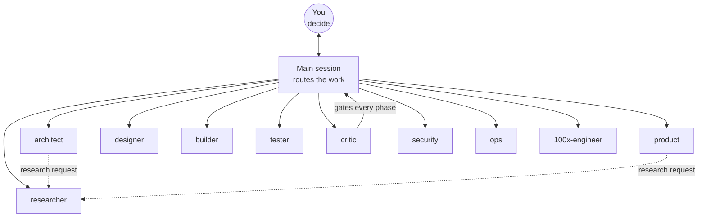

<p align="center"><picture><source media="(prefers-color-scheme: dark)" srcset=".github/logo-dark.svg"></picture></p>

# Majlis

**Your idea. Your team. Your call.**

A full team of AI agents for your idea, working in front of you, step by step.

A majlis is the room where people sit together to talk something through
before anyone acts. Majlis gives each new Claude Code project one: an
architect, a product lead, a builder, a tester, a critic and others, each with
a narrow job, a set of rules with the reason behind each one, a research
protocol that only investigates what blocks the next step, and a decision log
you can publish as a page. It ships no stack and no product code. Those are the
first decisions your project makes, with the team.

> **Status: pre-release.** Majlis is not on PyPI yet. Until it is, clone this
> repo and run `pipx install ./majlis` (or `uv tool install ./majlis`), or run it
> without installing (below).

## Quick start

```bash
pipx install majlis        # or: uv tool install majlis
majlis new my-idea
cd my-idea && claude
```

Then say **"set up this project"** and describe the idea in a few sentences.
Claude fills in what it can, asks one batch of questions for the rest, turns
the right modules on (more than one language, an AI feature), creates the repo,
and leaves a `CLAUDE.md` whose last line says what comes next. Start the first
phase with "run the architect on the Phase 0 brief in CLAUDE.md".

From a clone, without installing: `PYTHONPATH=<clone> python3 -m majlis new my-idea`.
Run that way, `majlis sync` follows the clone's committed `main`.

Requires Python 3.10 or later, Git, and Claude Code. The GitHub CLI (`gh`) is
used when setup creates the repo.

## What you get



**The team.** Ten agents in `.claude/agents/`, each with one job:

| Agent | Job | Model |
|---|---|---|
| architect | Stack, data model, structure; writes the ADRs | Opus |
| product | What each flow does, what is in scope, acceptance criteria | Opus |
| designer | The design system and every interface (ui module, on by default) | Opus |
| builder | Writes the code and its unit tests, from specs and ADRs | Opus |
| tester | Acceptance and end-to-end tests from the specs | Sonnet |
| critic | Adversarial review at every phase gate | Opus |
| security | The threat model; reviews changes to auth, data, secrets | Opus |
| ops | Deployment, CI, monitoring, backups, runbooks | Sonnet |
| researcher | Answers research requests at a set depth, with sources | Sonnet |
| 100x-engineer | Whole-codebase review before a release; writes the builder's specs | Fable |

**The rules.** Short working rules in `.claude/rules/`, each with the reason it
exists: research only what blocks the next step; record each decision in
exactly one place; keep pull requests reviewable; never call work done until
someone has used it as the user would.

**What you see.** Decisions are recorded in the repo and rendered as a page:
architecture decisions, research and the choices made from it, and the rules.
A status page shows where the project stands.

You stay the decision-maker. An agent that hits a choice it cannot settle from
the project's own documents asks you, and a rule it drafted never becomes a
gate without your yes.

## Modules

Turn one on with `majlis enable <module>`, off with `majlis disable <module>`:

| Module | For |
| --- | --- |
| `ai` | Products that call a model at runtime: an ai agent, its rule, and evals. |
| `i18n` | More than one language, or any right-to-left one. |
| `content` | Products where the content is the product: an editor agent. |
| `legal` | Minors, payments, health or financial data, or regulated clients. |
| `beads` | A shared work queue with a local board (on by default). |

## It stays current

Most starters are a copy: useful on day one, frozen from then on. Majlis
records what each project received, and splits the files in two:

- **Shared** files (the agents, most rules, the docs READMEs, the renderers)
  belong to Majlis. When they improve, your next session opens with a one-line
  notice.
- **Owned** files (`CLAUDE.md`, `README.md`, your settings and constraints, and
  everything you create) belong to the project. Nothing touches them.

```bash
majlis sync            # preview: what changes, with line counts
majlis sync --apply    # write it; review with git diff, commit on a branch
```

If you edited a shared file, sync calls it a conflict and leaves it alone
while the rest updates. Take Majlis's version with `--take <path>`, or make the
file yours for good with `majlis detach <path>`. Each release's changes to a
project are in `CHANGELOG.md`.

## Commands

```text
majlis new <slug>        create a project
majlis enable <module>   turn a module on      majlis disable <module>
majlis sync              preview updates       --apply, --diff, --all, --take <path>
majlis detach <path>     stop syncing a file
majlis lint              check the research, decision and size rules
majlis research-find <words>  search earlier research across your projects
majlis adopt <path>      bring an existing project in
majlis migrate           move a project from an older template onto Majlis
```

Projects are created in the current directory, or under `MAJLIS_ROOT` when set
(`--root <dir>` overrides both). `majlis --version` prints the version.

## What it costs

Majlis is free. The agents run in your Claude Code session, so they use your
Claude plan. Majlis makes no calls of its own and sends nothing anywhere: there
is no telemetry. The heavy agents are the Opus ones and the Fable-pinned
100x-engineer, which runs rarely, before a release. On a smaller plan, move
those to Sonnet: every agent's `model:` line can be changed in your project,
which makes that file yours (`detach`).

## FAQ

**What does Phase 0 produce?** Two architecture decisions (the stack and the
core data model), the research they needed, and a phase plan cut into slices a
user could try. Every later phase is one such slice, end to end.

**Can I use it on an existing project?** Yes: `adopt` brings the shared files
in and never overwrites a file the project owns. The dry run lists every
replacement first.

## Contributing

Issues and pull requests are welcome. Read [CONTRIBUTING.md](CONTRIBUTING.md)
first; the maintainer guide is [MAINTAINING.md](MAINTAINING.md).

If Majlis saves you time, you can [sponsor the project](https://github.com/sponsors/ashaherb).

## License

[Apache 2.0](LICENSE). Made by [Ahmed Shaher](https://github.com/ashaherb).
