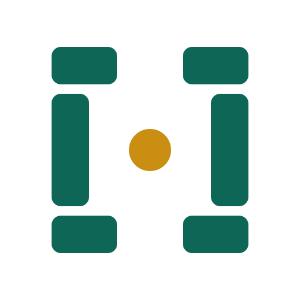

<p align="center"><picture><source media="(prefers-color-scheme: dark)" srcset=".github/logo-dark.svg"></picture></p>

# Majles

**Your idea. Your team. Your call.**

A full team of AI agents for your idea, working in front of you, step by step.

A majles is the room where people sit together to talk something through
before anyone acts. Majles gives each new Claude Code project one: an
architect, a product lead, a builder, a tester, a critic and others, each with
a narrow job, a set of rules with the reason behind each one, and a decision
log you can publish as a page. It ships no stack and no product code. Those are
the first decisions your project makes, with the team.

> **Status: pre-release.** Version 0.1.0 is not on PyPI yet, and the `majles`
> name there holds a placeholder. Until it is published, install from a clone:
> see [Installing before 0.1.0](#installing-before-010).

## Quick start

You need Python 3.10 or later, Git, [Claude Code](https://docs.claude.com/en/docs/claude-code),
and the GitHub CLI (`gh`), signed in. Setup uses `gh` to create a private
GitHub repo for the project.

### 1. Install

```bash
pipx install majles
# or
uv tool install majles
```

`majles --version` confirms it is on your path.

### 2. Create the project

```bash
majles new my-idea
```

This creates `my-idea` in the current directory and prints the next step:

```text
Created ~/code/my-idea from Majles @0.1.0.
Next: cd ~/code/my-idea && claude, then say "set up this project".
```

The folder holds the agents, the rules, the `docs/` folders and a setup guide,
`SETUP.md`. `.majles.json` records what was copied. It is not a git repo yet;
setup makes it one.

### 3. Give Claude the first prompt

```bash
cd my-idea
claude
```

Say **"set up this project"**, then describe the idea in a few sentences. For
example:

> Set up this project. It is a small web app where a running club posts its
> weekly routes and members say whether they are coming. English only. No
> payments and no AI features. I want it working for my own club first.

The more the description says, the fewer questions follow.

### 4. Answer one batch of questions

Claude follows `SETUP.md`, in order:

1. It fills what it can from your description, then asks **one batch** of
   questions for the rest: the name, who it is for, what must never be
   compromised, what the first version must do, what is out of scope,
   which languages, whether it calls an AI model, and whether it involves
   minors, payments, or health or financial data. It does not ask what you
   already said.
2. It writes your own words, quoted and dated, in `docs/direction.md`. A rule
   Claude drafted for you is marked "drafted", and never becomes a gate without
   your yes.
3. It turns [modules](#modules) on or off to match your answers.
4. It runs `git init`, creates a private GitHub repo with `gh`, and turns on a
   git hook that refuses pushes to `main`.
5. It sets up the work queue, unless you say no: Beads (`bd`) and its local
   board, installed with Homebrew and npm.
6. It renders the decision log and a status page as HTML, and publishes each
   as an Artifact.
7. It deletes `SETUP.md`, makes the first commit, and pushes it. That is the
   only push straight to `main`. Everything after goes through a branch and a
   pull request.

At the end it asks you to start a new Claude Code session, so the agents, the
rules and the session-start hook load.

### 5. Start Phase 0

In the new session, say:

> run the architect on the Phase 0 brief in CLAUDE.md

What happens next:

- The architect writes research requests in `docs/research/` first: the stack
  and hosting, the hardest technical question you named, and how the data model
  can grow. Then it stops and hands back.
- Claude, in your session, puts the architect's questions to you, then runs a
  researcher on each request and saves each reply, unedited, as `findings.md`.
- The architect writes a `decision.md` for each research task, then two
  architecture decisions (the stack and the core data model), a phase plan cut
  into slices a user could try, `docs/open-questions.md`, and only the
  scaffolding the stack needs. No feature code.
- The critic reviews it. Then it is your turn: argue with at least two of the
  decisions before any feature code is written.

Each later phase is one slice, end to end. The **Next:** line in `CLAUDE.md`
always says what comes next.

### Where decisions land

| What | Where |
| --- | --- |
| Your own words, quoted and dated | `docs/direction.md` |
| Architecture: the choices that are hard to reverse | `docs/adr/` |
| What a user gets, one spec per flow | `docs/specs/` |
| Choices made from research, beside the request and findings | `docs/research/<task>/decision.md` |
| How the team works | `.claude/rules/` |
| The critic's reviews | `docs/reviews/` |
| The phase, the status and the next step | `CLAUDE.md` |

`python3 tools/render_decisions.py <out.html>` renders them as one page.

### Installing before 0.1.0

Pre-release only. Clone this repo, then install from the clone:

```bash
pipx install ./majles        # or: uv tool install ./majles
```

Or run it without installing: `PYTHONPATH=<clone> python3 -m majles new my-idea`.
Run that way, Majles reads the template from the clone's last commit, and
`majles sync` follows it. The session-start notice needs `majles` on your path,
so it stays silent.

## What you get

**The team.** Ten agents in `.claude/agents/`, each with one job:

| Agent | Job | Model |
|---|---|---|
| architect | Stack, data model, structure; writes the ADRs | Opus |
| product | What each flow does, what is in scope, acceptance criteria | Opus |
| designer | The design system and every interface (ui module) | Opus |
| builder | Writes the code and its unit tests, from specs and ADRs | Opus |
| tester | Acceptance and end-to-end tests from the specs | Sonnet |
| critic | Adversarial review at every phase gate | Opus |
| security | The threat model; reviews changes to auth, data, secrets | Opus |
| ops | Deployment, CI, monitoring, backups, runbooks | Sonnet |
| researcher | Answers research requests at a set depth, with sources | Sonnet |
| 100x-engineer | Whole-codebase review before a release; writes the builder's specs | Fable |

**The rules.** Short working rules in `.claude/rules/`, each with the reason it
exists: research only what blocks the next step; record each decision in
exactly one place; keep pull requests reviewable; never call work done until
someone has used it as the user would.

You stay the decision-maker. An agent that hits a choice it cannot settle from
the project's own documents asks you.

## Modules

New projects start with `ui` and `beads` on. Setup changes them from your
answers, or you can later: `majles enable <module>`, `majles disable <module>`.

| Module | For |
| --- | --- |
| `ui` | A visual interface: the designer and `design/`. On by default. |
| `beads` | A shared work queue with a local board. On by default. |
| `i18n` | More than one language, or any right-to-left one. |
| `content` | Products where the content is the product: an editor agent. |
| `ai` | Products that call a model at runtime: an ai agent, its rule, and evals. |
| `legal` | Minors, payments, health or financial data, or regulated clients. |

## Keeping it current

Majles records what each project received, and splits the files in two:

- **Shared** files (the agents, most rules, the docs READMEs, the renderers)
  belong to Majles. When a newer Majles changes them, your next session opens
  with a one-line notice.
- **Owned** files (`CLAUDE.md`, `README.md`, your settings and constraints, and
  everything you create) belong to the project. Sync never touches them.

```bash
majles sync            # preview: what changes, with line counts
majles sync --apply    # write it; review with git diff, commit on a branch
```

If you edited a shared file, sync calls it a conflict and leaves it alone
while the rest updates. Take Majles's version with `--take <path>`, or keep
yours for good with `majles detach <path>`. Each release's changes are in
[CHANGELOG.md](CHANGELOG.md).

## An existing project

```bash
cd my-existing-project
majles adopt --modules core,ui,i18n           # dry run: lists every file it adds or replaces
majles adopt --modules core,ui,i18n --apply
```

`adopt` sets every shared file to the Majles version, so move anything
project-specific out of the files the dry run marks `update` first. It never
overwrites a file the project owns. The dry run also lists what your own
`.gitignore` and `README.md` lack. Your `CLAUDE.md` stays, with the template
beside it as `CLAUDE.majles.md` for setup to merge. Without `--modules` it uses
`core,ui,beads`. Then open Claude Code and say "set up this project from
SETUP.md".

A project made under one of Majles's earlier names moves over with
`majles migrate`, then `majles sync --apply`, on a branch.

## Commands

```text
majles new <slug>             create a project in the current directory
majles enable <module>        turn a module on
majles disable <module>       turn a module off
majles sync                   preview updates: --apply, --diff, --take <path>, --all
majles detach <path>          the project takes over a shared file; sync skips it
majles lint                   check the research, ADR, size and main-branch rules
majles placeholders           list the setup placeholders left in the project's files
majles check                  what the session-start hook runs; quiet unless there is news
majles research-find <words>  search earlier research in every project under the root
majles adopt                  bring an existing project in
majles migrate                move a project made under an earlier name onto Majles
```

Commands that act on one project use the current directory, or take its path
as a last argument. The root, where `new` creates projects and `--all` and
`research-find` look, is `--root <dir>`, else `$MAJLES_ROOT`, else the current
directory. `majles --version` prints the version.

## What it costs

Majles is free. The agents run in your Claude Code session, so they use your
Claude plan. The `majles` command makes no network calls of its own and sends
nothing anywhere: there is no telemetry. The heavy agents are the Opus ones and
the 100x-engineer, which runs rarely, before a release. On a smaller plan, move
those to Sonnet: change the agent's `model:` line, which makes that file yours
(`majles detach`).

## Contributing

Issues and pull requests are welcome. Read [CONTRIBUTING.md](CONTRIBUTING.md)
first; the maintainer guide is [MAINTAINING.md](MAINTAINING.md).

If Majles saves you time, you can [sponsor the project](https://github.com/sponsors/ashaherb).

## License

[Apache 2.0](LICENSE). Made by [Ahmed Shaher](https://github.com/ashaherb).
